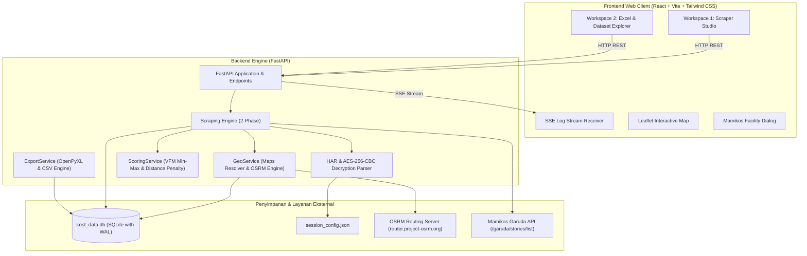

# Arsitektur Sistem: Mamikos Scraping & Location Intelligence System (V2.0)

Dokumen ini memuat arsitektur menyeluruh sistem scraping, pemrosesan inteligensi lokasi, basis data, dan antarmuka pengguna.

---

## 1. Ringkasan Eksekutif & Tujuan Sistem
Sistem ini memfasilitasi pencarian dan evaluasi kost di platform Mamikos secara terprogram dan terukur:
- Mengakses endpoint internal Mamikos menggunakan session token dan dekripsi AES-256-CBC.
- Mengintegrasikan rute berkendara riil menggunakan OSRM (*Open Source Routing Machine*) menuju target lokasi pengguna.
- Menghitung skor terbobot *Value-for-Money* (VFM) berbasis harga dan jarak.
- Menyediakan antarmuka *Dual Workspace*: **Scraper Studio** untuk kontrol & monitoring real-time, dan **Excel & Dataset Explorer** untuk analisis spreadsheet 26 kolom.

---

## 2. Diagram Arsitektur Komponen

---

## 3. Two-Phase Scraping Pipeline

Untuk mengoptimalkan kecepatan pencarian dan efisiensi kuota request, proses scraping dibagi menjadi dua fase:

### Fase 1: Fast Discovery (Bulk Ingestion)
- **Target**: Mengumpulkan puluhan hingga ratusan kost dalam waktu singkat.
- **Mekanisme**: Memanggil endpoint `/garuda/stories/list` dengan pagination per 20 listing.
- **Enkripsi**: Respons terenkripsi di-decrypt menggunakan AES-256-CBC secara lokal di Python.
- **Rute & Skor**: Koordinat listing langsung dikirim ke OSRM untuk menghitung jarak motor, mobil, dan jalan kaki ke titik target, lalu dihitung skor VFM awal.
- **Output**: Listing tersimpan ke SQLite dan langsung dirender di tabel dan peta.

### Fase 2: Deep Enrichment (On-Demand)
- **Target**: Mengambil data kontak, alamat lengkap, dan aturan kost.
- **Mekanisme**: Dipicu secara selektif oleh pengguna (melalui tombol *Enrich Selected* atau baris tertentu).
- **Endpoint**: Mengakses halaman detail kamar `/room/{slug}` atau API v3 Mamikos untuk mendapatkan WhatsApp pemilik, kebijakan deposit, dan fasilitas terperinci.

---

## 4. Persistensi Data & Strategi Caching (SQLite)

Database tersimpan di `backend/data/kost_data.db` dengan tabel utama:
1. `kost_listings`:
   - Primary key: `id` (string ID Mamikos).
   - Atribut geografis: `latitude`, `longitude`, `address`, `subdistrict`, `city`.
   - Atribut rute: `motorcycle_distance_km`, `motorcycle_duration_min`, `car_distance_km`, `car_duration_min`, `walk_distance_km`, `walk_duration_min`.
   - Atribut harga & scoring: `price_monthly`, `price_type`, `vfm_score`, `vfm_rating`.
   - Atribut operasional: `available_rooms`, `gender`, `rating`, `review_count`, `phone_number`, `detail_scraped`.
2. `route_cache`:
   - Menyimpan hasil kalkulasi OSRM berdasarkan hash koordinat `(source_lat, source_lng, target_lat, target_lng, profile)`.
   - Mencegah request berulang ke server OSRM publik saat kalkulasi ulang skor atau pergantian bobot.
